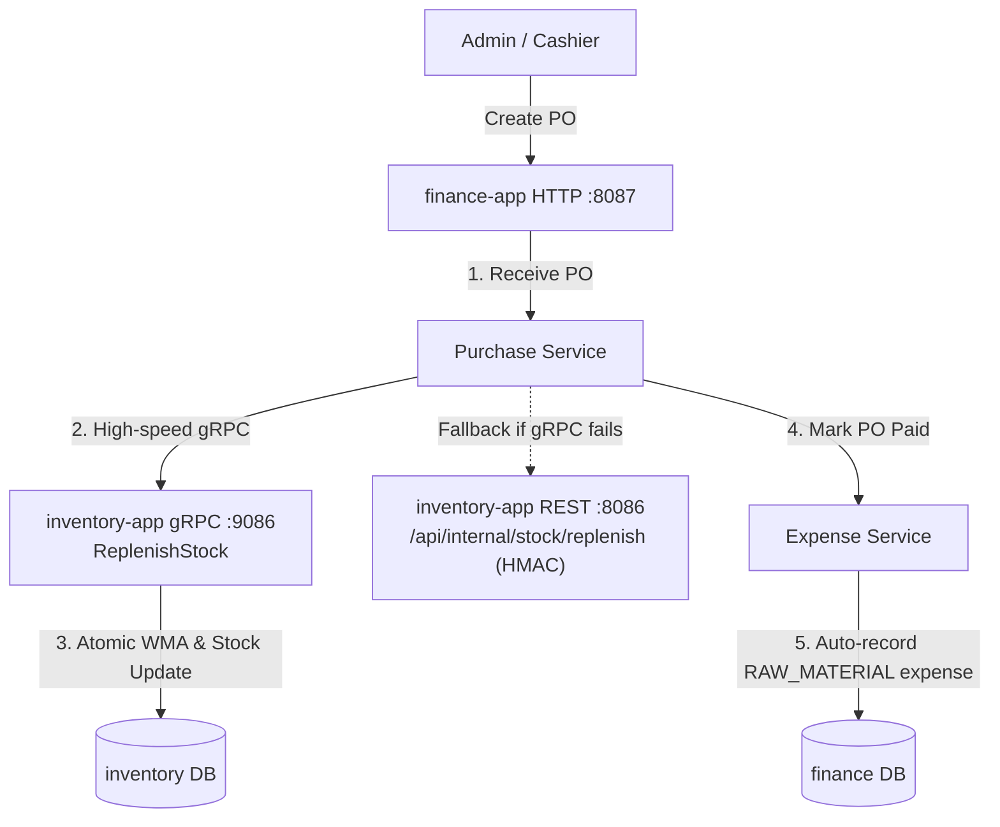

# ☕ Coffe Finance & Purchasing Microservice (`finance-app`)

Microservice built with **Rust (Axum + Tonic gRPC + SQLx + Redis + RabbitMQ)** for the **Coffe** microservices ecosystem. It handles Supplier management, Purchase Orders (PO), Operational Expenses (COGS & OPEX), and Cash Flow & Financial Reporting.

---

## 🚀 Core Features

- **Supplier Directory (`/api/v1/suppliers`)**:
  - Full CRUD for raw material and packaging vendors with contact details and terms.
- **Purchase Orders (`/api/v1/purchases`)**:
  - Create purchase orders with multiple line items (`ingredient_id`, `quantity`, `unit_cost`, `subtotal`).
  - Calculate order totals and status lifecycle (`DRAFT` -> `ORDERED` -> `RECEIVED` -> `CANCELLED`).
  - **Automated Stock Replenishment**: Marking a purchase order as received (`POST /:id/receive`) triggers gRPC `ReplenishStock` on `inventory-app` (updating stock balances, recalculating Weighted Moving Average unit cost, and logging stock movements). Resilient fallback to HTTP REST with HMAC-SHA256 signature is included.
  - **Automated Expense Booking**: Marking a purchase order as paid (`POST /:id/pay`) automatically creates an operational expense under category `RAW_MATERIAL`.
- **Operational Expenses (`/api/v1/expenses`)**:
  - Record operational disbursements (rent, utilities, salaries, maintenance, marketing).
  - Categorized expense summary (`/api/v1/expenses/summary?from=...&to=...`).
- **Financial & Profit/Loss Reporting (`/api/v1/reports`)**:
  - Comprehensive P&L summary: Total revenue, COGS, Gross Profit, Operating Expenses, Net Profit, and margin percentages.
  - Monthly expense breakdown and trends.
- **Resilient East-West Integration**:
  - Tonic gRPC client communicating with `inventory-app` on port `:9086`.
  - Automatic fallback to HTTP REST (`POST /api/internal/stock/replenish`) protected with HMAC-SHA256 signatures (`X-Signature`, `X-Timestamp`, `APP_SECRET`).

---

## ⚡ Port Mapping

| Protocol | Port | Description |
| :--- | :--- | :--- |
| **HTTP REST** | `:8087` | Health check (`/health`), CRUD Suppliers, Purchases, Expenses, Reports |
| **gRPC Server** | `:9087` | gRPC service listener |

---

## 🔄 Inter-Service Workflows



---

## 🛠️ Tech Stack

- **Runtime**: Rust (Edition 2021)
- **Web Framework**: Axum 0.7
- **gRPC Client & Server**: Tonic 0.12 + Prost
- **Database**: PostgreSQL with SQLx 0.8 (compile-time checked async SQL queries)
- **Caching & Messaging**: Redis 0.27, Lapin (AMQP / RabbitMQ) 2.5
- **Telemetry**: Tracing + OpenTelemetry OTLP

---

## 🧪 Testing

Run all unit and integration test suites:
```bash
cargo test
```
